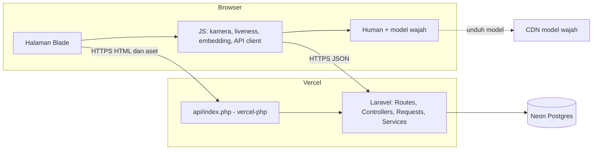
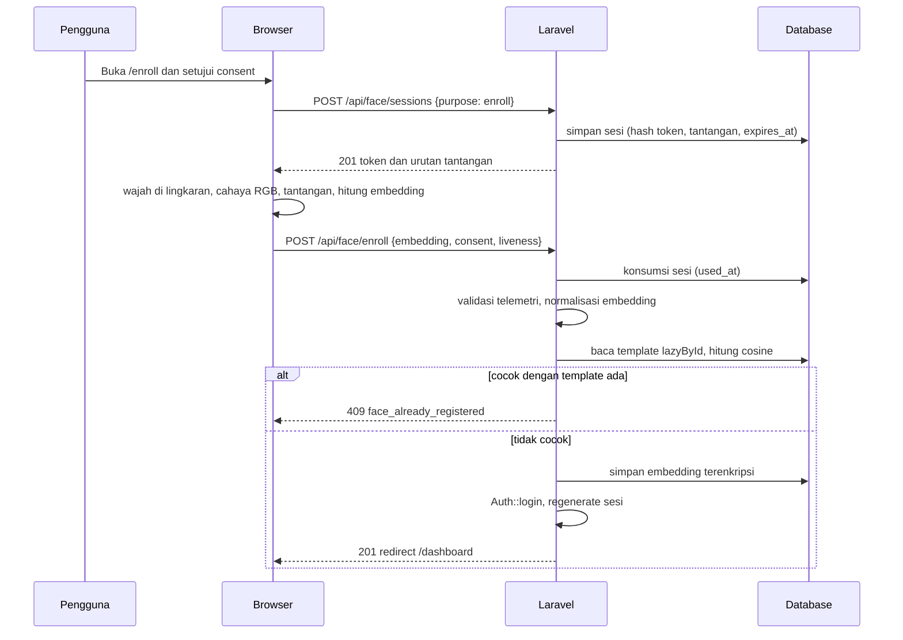
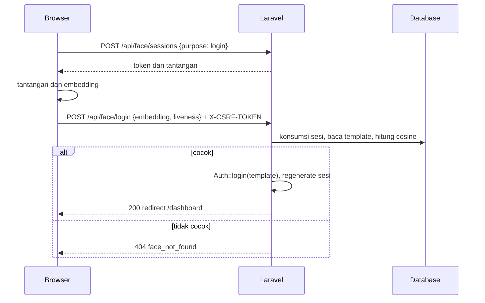

# ARCHITECTURE

Dokumen ini menjelaskan struktur teknis `face-registry`. Fitur (F-xx) dan angka acuan ada di `docs/PRD.md`.

## 1. Tech stack
| Lapisan | Pilihan | Alasan |
|---|---|---|
| Backend | PHP ≥ 8.2, Laravel ≥ 11 | Pilihan pemilik. Routing, validasi, enkripsi (`Crypt`), rate limiter sudah tersedia. `TODO:` versi final setelah spike Vercel |
| Frontend | Blade + JavaScript ES modules | Satu repo, tanpa framework SPA, mudah dimodifikasi |
| Deteksi wajah, liveness, embedding | `@vladmandic/human` | Satu library untuk landmark, kedip, yaw, dan embedding. Tidak perlu model terpisah `[REKOMENDASI]` |
| Build frontend | Vite | Bawaan Laravel |
| Database | PostgreSQL (Neon) demo, SQLite lokal dan test | Penyimpanan permanen di luar fungsi serverless. Skema portabel ke MySQL |
| Hosting | Vercel (`vercel-php@0.9.0`, region `sin1`) | Pilihan pemilik. Runtime komunitas, lihat risiko di PRD |
| Test | Pest, Vitest, Playwright | `[REKOMENDASI]` |
| Lint | Laravel Pint, ESLint | `[REKOMENDASI]` |

## 2. Diagram arsitektur


## 3. Struktur folder
```
face-registry/
├── app/
│   ├── Enums/                      # LivenessPurpose, ChallengeType, FaceErrorCode
│   ├── Exceptions/Face/            # FaceException (membawa FaceErrorCode)
│   ├── Http/
│   │   ├── Controllers/Face/       # SessionController, EnrollController, LoginController,
│   │   │                           # AccountController (tipis)
│   │   ├── Middleware/             # SecurityHeaders (Permissions-Policy, CSP, no-store)
│   │   └── Requests/Face/          # validasi input per endpoint
│   ├── Models/                     # FaceTemplate (akun), Attendance, LivenessSession
│   ├── Services/Face/              # semua logika bisnis (lihat bagian 4)
│   └── Console/Commands/           # face:seed-fake (hanya non-production)
├── bootstrap/app.php               # middleware, exception handler format error API
├── config/face.php                 # threshold, timeout, batas template, rate limit
├── config/auth.php                 # model akun = FaceTemplate
├── database/
│   ├── migrations/
│   └── factories/                  # FaceTemplateFactory (vektor sintetis)
├── lang/id/face.php                # teks UI Bahasa Indonesia
├── public/                         # aset statis; hasil build di public/build
├── resources/
│   ├── js/face/
│   │   ├── main.js                 # entry per halaman
│   │   ├── config.js               # baca konfigurasi dari atribut data di Blade
│   │   ├── camera.js               # getUserMedia, stream
│   │   ├── detector.js             # pembungkus Human
│   │   ├── circleGuide.js          # cek wajah di dalam lingkaran
│   │   ├── lightEffect.js          # overlay merah, biru, hijau (F-04)
│   │   ├── liveness/               # blink.js, headTurn.js, flow.js (urutan tantangan)
│   │   └── apiClient.js            # fetch ke /api/face/*
│   └── views/face/                 # layout, login, enroll, dashboard
├── routes/web.php                  # halaman, form, dan /api/face/* (grup web)
├── tests/{Unit, Feature, js, e2e}
├── api/index.php                   # entry Vercel, set path tulis ke /tmp
├── vercel.json, .vercelignore
└── docs/
```

## 4. Komponen utama dan tanggung jawab
| Komponen | Tanggung jawab | Fitur |
|---|---|---|
| `SessionController` | Membuat sesi liveness (token, urutan tantangan) | F-01 |
| `EnrollController` | Enroll lewat service, lalu `Auth::login` | F-02, F-05, F-09, F-18 |
| `LoginController` | Masuk dengan wajah lewat service, lalu `Auth::login` | F-18 |
| `AccountController` | Dashboard, nama, hapus riwayat, hapus akun, keluar (form Blade biasa) | F-19, F-21 |
| `AttendController` | Absen dengan foto wajah, cocok 1:1 dengan akun yang masuk | F-20 |
| `LivenessSessionService` | Buat, cari, dan konsumsi sesi (sekali pakai). Membersihkan sesi kedaluwarsa secara oportunistik | F-01 |
| `LivenessValidator` | Validasi telemetri tantangan terhadap sesi dan waktu server | F-03 |
| `EmbeddingCodec` | Normalisasi L2, pack/unpack float32, enkripsi/dekripsi | F-10 |
| `FaceMatcher` | Cosine similarity 1:N (`lazyById`, memori tetap kecil) untuk enroll/login, dan 1:1 untuk absen | F-05, F-18, F-20 |
| `FaceTemplateService` | Alur lengkap enroll dan login, serta batas jumlah template | F-05, F-13, F-18 |
| JS `flow.js` | Menjalankan urutan tantangan sesuai server, mengumpulkan telemetri | F-03 |
| JS `detector.js` | Menghasilkan landmark, yaw, EAR, dan embedding | F-02, F-03 |
| `SecurityHeaders` | `Permissions-Policy: camera=(self)`, CSP, `Cache-Control: no-store` pada `/api/face/*`. CSP harus mengizinkan WASM/WebGL dan domain `FACE_MODEL_URL` untuk Human (nilai pastinya dicatat di T-004, diterapkan di T-013) | F-14 |

Controller hanya memanggil Form Request dan Service. Tidak ada logika bisnis di controller.

## 5. Alur data
### 5.1 Enroll (F-01, F-02, F-03, F-05, F-09, F-10, F-18)


### 5.2 Masuk (F-18)


### 5.3 Dashboard (F-19, F-20, F-21)
Form Blade biasa dengan `@csrf` ke `AccountController`: `PUT /account/name`, `DELETE /attendance`, `DELETE /account` (cascade ke `face_attendances`), `POST /logout`.

Absen (ADR-021): `scanner.js` dengan `purpose: null` hanya menunggu posisi wajah lalu mengambil embedding, tanpa sesi liveness. `POST /api/face/attendance` → `AttendController` → `FaceTemplateService::attend` → `FaceMatcher::matches` (1:1 dengan akun yang masuk) → `firstOrCreate` per tanggal (dijaga index unik).

## 6. Autentikasi dan otorisasi
- Akun = baris `face_templates` (ADR-020). Guard `web` bawaan Laravel, sesi di tabel `sessions`. Tidak ada password: satu-satunya cara masuk adalah pindai wajah yang lolos liveness dan cocok di atas threshold.
- Endpoint JSON ada di grup `web` dengan prefix `api/face`, dilindungi oleh: (1) token sesi liveness sekali pakai di database, (2) rate limiting per IP (F-11), (3) CSRF, (4) tanpa skor di respons.
- Rute dashboard memakai middleware `auth`. Setiap aksi hanya menyentuh akun `$request->user()`.
- Same-origin saja (tanpa CORS).
- Rahasia: `APP_KEY` dipakai `Crypt` (embedding dan nama). Mengganti `APP_KEY` membuat semua template dan nama tidak terbaca. Rotasi kunci di luar cakupan v1 (`TODO:`).

## 7. Penanganan error dan logging
- Semua error `/api/*` dipetakan ke format standar di `docs/API.md` lewat exception handler di `bootstrap/app.php`.
- `FaceException` membawa `FaceErrorCode`. Kode yang tidak dikenal menjadi `server_error` (HTTP 500) tanpa detail internal.
- Log ke `stderr` (`LOG_CHANNEL=stderr`). Konteks log hanya `request_id`, `error_code`, dan nama endpoint.
- Dilarang masuk log: embedding, nama, token sesi, isi telemetri, body request endpoint `/api/face/*`.
- Frontend menampilkan pesan dari `lang/id/face.php` berdasarkan `error.code`, bukan teks mentah dari server.

## 8. Strategi testing
| Level | Alat | Isi |
|---|---|---|
| Unit PHP | Pest | `FaceMatcher` (cosine, threshold), `EmbeddingCodec` (round trip, enkripsi), `LivenessValidator` (urutan, durasi, ambang) |
| Feature PHP | Pest + SQLite in-memory | Semua endpoint, semua kode error, rate limit 429, sesi sekali pakai, batas template, tidak ada skor di respons |
| Unit JS | Vitest | Hitungan EAR dan yaw dari fixture landmark sintetis, state machine tantangan |
| E2E | Playwright + kamera palsu Chrome `[REKOMENDASI]` | Smoke test halaman dan alur sampai pengiriman, bukan akurasi liveness |
| Manual | Daftar periksa | Perangkat nyata (Android, iOS, laptop), uji foto dan video putar ulang (M-2), pengukuran M-1 |
| Performa | `face:seed-fake` | Isi 2.000 template sintetis di lingkungan non-production, ukur login (M-3) |

- Fixture dan data uji tidak boleh berisi wajah asli. Gunakan vektor acak dan landmark sintetis.
- Target coverage `app/Services/Face` ≥ 80% (M-6).

## 9. Environment dan deployment
| Environment | Tempat | Database | Catatan |
|---|---|---|---|
| Dev | Lokal (`composer dev`) | SQLite | Kamera di `localhost` diizinkan tanpa HTTPS |
| Staging | Vercel Preview (branch/PR), `APP_ENV=staging` | Neon branch terpisah `[REKOMENDASI]` | Dipakai untuk uji performa dan uji perangkat |
| Production (demo) | Vercel, branch `main` | Neon database utama | Auto-deploy dari GitHub |

Deployment ke Vercel:
- `vercel.json`: region `sin1`, `functions` memakai `vercel-php@0.9.0`, route `/build/*` dan aset statis ke `public/`, sisanya ke `api/index.php`. Setiap aset statis tambahan butuh baris route sendiri.
- `api/index.php`: membuat folder tulis di `/tmp` dan mengisi env `LARAVEL_STORAGE_PATH`, `APP_*_CACHE`, `VIEW_COMPILED_PATH`, lalu memuat `public/index.php`.
- `.vercelignore`: `/public/hot`, `/.env*`, kecuali `/.env.example`.
- Env: `SESSION_DRIVER=database`, `CACHE_STORE=database`, `QUEUE_CONNECTION=sync`, `LOG_CHANNEL=stderr`, koneksi Neon (`DB_*`, `DB_SSLMODE=require`). Variabel S3 tidak dipakai.
- Migrasi manual: `php artisan migrate --force` (ke Neon, bukan saat build).
- `face:seed-fake` menolak jalan jika `APP_ENV=production`. Jalankan dari komputer lokal dengan `DB_*` mengarah ke Neon branch staging dan `APP_ENV=staging` (sama seperti `migrate --force`), bukan di dalam fungsi Vercel.
- `TODO:` verifikasi versi PHP yang disediakan `vercel-php@0.9.0`, batas ukuran bundle, dan kebutuhan trik `connect_via_database` untuk Neon (spike Tahap 0).
- Model wajah: dimuat dari CDN dengan versi di-pin (URL lewat `FACE_MODEL_URL`), tidak melewati fungsi PHP. `TODO:` putuskan self-host atau tetap CDN untuk penggunaan di luar demo.
- Pembersihan sesi kedaluwarsa dilakukan oportunistik saat membuat sesi (tanpa scheduler), karena Vercel tidak menjalankan `schedule:run`.

## 10. Integrasi pihak ketiga
| Layanan | Fungsi | Data yang keluar |
|---|---|---|
| Vercel | Hosting aplikasi | Seluruh trafik aplikasi |
| Neon | Database Postgres | Embedding terenkripsi, hash, sesi |
| CDN model (mis. jsDelivr) | Menyajikan file model wajah | IP pengguna terlihat oleh CDN |
| `@vladmandic/human` | Library deteksi dan embedding (npm) | Tidak ada (berjalan di browser) |

Tidak ada analytics atau layanan lain. `TODO:` verifikasi lisensi model wajah.
