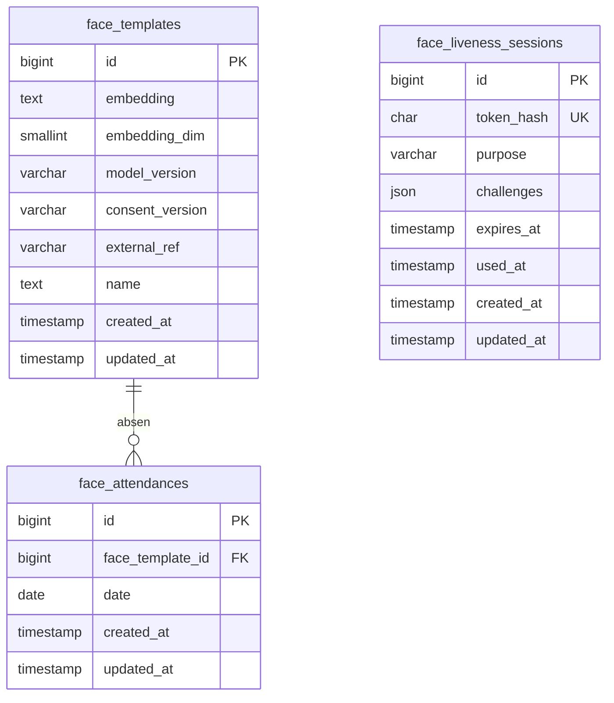

# DATABASE

Database dipakai untuk menyimpan akun (template wajah dan nama), absen, dan state sesi liveness. Fitur terkait: F-01, F-05, F-09, F-10, F-16, F-18–F-21. Vercel tidak menyediakan penyimpanan permanen, jadi data tidak boleh disimpan di file atau memori.

Skema harus portabel ke MySQL, PostgreSQL, dan SQLite: tanpa `jsonb`, tanpa tipe vektor khusus.

Kolom `delete_code_hash` dan kode hapus sudah dihapus (migrasi `2026_11_21_000001`, ADR-020).

## Tabel `face_templates`
Satu baris per wajah terdaftar, sekaligus satu akun (ADR-020). Dipakai sebagai model `Authenticatable` Laravel.

| Field | Tipe | Constraint | Keterangan |
|---|---|---|---|
| `id` | bigint unsigned | PK, auto increment | Tidak pernah ditampilkan ke klien |
| `embedding` | text | NOT NULL | Ciphertext hasil `Crypt::encryptString` dari embedding ternormalisasi L2 (float32 dikemas biner). Tidak pernah berisi plaintext |
| `embedding_dim` | smallint unsigned | NOT NULL | Jumlah dimensi vektor, divalidasi saat enroll |
| `model_version` | varchar(40) | NOT NULL | Versi model/embedding saat enroll. Template berbeda versi tidak dibandingkan |
| `consent_version` | varchar(20) | NOT NULL | Versi teks consent yang disetujui (F-09) |
| `external_ref` | varchar(191) | NULL | Disiapkan untuk integrasi HRIS (F-16). Tidak dipakai di v1 |
| `name` | text | NULL | Nama yang diisi pengguna di dashboard (F-19), terenkripsi lewat cast `encrypted`. NULL sampai diisi |
| `created_at` | timestamp | NOT NULL | |
| `updated_at` | timestamp | NOT NULL | |

Catatan:
- Embedding disimpan sebagai biner terenkripsi, bukan JSON, agar ukuran kecil dan karena ciphertext memang bukan JSON. Ini mengubah ide awal "embedding sebagai JSON" (lihat `DECISIONS.md`).
- Estimasi ukuran `[ASUMSI]`: ±8 KB per template untuk 1024 dimensi, sehingga satu full scan 2.000 template ±16 MB. Hitung ulang setelah dimensi final (`TODO:`).

## Tabel `face_liveness_sessions`
State sesi liveness (F-01, F-03). Sesi sekali pakai.

| Field | Tipe | Constraint | Keterangan |
|---|---|---|---|
| `id` | bigint unsigned | PK, auto increment | |
| `token_hash` | char(64) | NOT NULL, UNIQUE | SHA-256 hex dari token. Token asli (≥ 128 bit) hanya dikirim ke klien |
| `purpose` | varchar(20) | NOT NULL | `enroll`, `login`. Nilai lain disediakan untuk ekstensi (F-16) |
| `challenges` | json | NOT NULL | Urutan tantangan teracak, contoh `["turn_left","blink","turn_right"]` |
| `expires_at` | timestamp | NOT NULL | `created_at` + 120 detik `[ASUMSI]` |
| `used_at` | timestamp | NULL | Diisi saat pertama kali dipakai. Sesi dianggap terpakai walau validasi gagal |
| `created_at` | timestamp | NOT NULL | Dipakai juga untuk memeriksa waktu server di `LivenessValidator` |
| `updated_at` | timestamp | NOT NULL | |

## Tabel `face_attendances`
Satu baris per akun per hari absen (F-20). Jam absen = `created_at`.

| Field | Tipe | Constraint | Keterangan |
|---|---|---|---|
| `id` | bigint unsigned | PK, auto increment | |
| `face_template_id` | bigint unsigned | NOT NULL, FK `face_templates.id` ON DELETE CASCADE | Pemilik absen. Hapus akun ikut menghapus absen |
| `date` | date | NOT NULL, UNIQUE bersama `face_template_id` | Tanggal menurut `APP_TIMEZONE` |
| `created_at` | timestamp | NOT NULL | Jam absen |
| `updated_at` | timestamp | NOT NULL | |

## Tabel framework
Karena `SESSION_DRIVER=database` dan `CACHE_STORE=database`, migrasi bawaan Laravel diperlukan: `sessions`, `cache`, `cache_locks`, dan `migrations`. Rate limiter memakai tabel `cache`. Tabel `jobs` tidak diperlukan karena `QUEUE_CONNECTION=sync`.

## Relasi
- `face_templates` 1 — N `face_attendances` (cascade delete).
- Sengaja **tidak ada relasi** antara `face_templates` dan `face_liveness_sessions`. Sesi liveness tidak menyimpan referensi ke akun. Sesi masuk Laravel (`sessions.user_id`) yang menghubungkan browser dengan akun.

## ERD

## Index penting
| Tabel | Index | Alasan |
|---|---|---|
| `face_templates` | INDEX `model_version` | Pencocokan hanya pada versi model aktif |
| `face_templates` | INDEX `external_ref` | Disiapkan untuk F-16 |
| `face_attendances` | UNIQUE (`face_template_id`, `date`) | Satu absen per hari, dan pencarian riwayat per akun |
| `face_liveness_sessions` | UNIQUE `token_hash` | Pencarian sesi per token |
| `face_liveness_sessions` | INDEX `expires_at` | Pembersihan sesi kedaluwarsa |

## Aturan migrasi
- Migrasi yang sudah dijalankan di demo tidak boleh diedit. Perubahan skema = migrasi baru.
- Setiap migrasi punya `down()` yang berfungsi.
- Hanya tipe portabel: `text`, `json`, `char`, `varchar`, `smallint`, `bigint`, `date`, `timestamp`.
- Migrasi dijalankan manual di Vercel/Neon: `php artisan migrate --force`.
- Pembersihan sesi kedaluwarsa: hapus baris `expires_at < now()` secara oportunistik saat `POST /api/face/sessions` (peluang `[ASUMSI]` 1 dari 20 request).

## Seed data
- Tidak ada seeder untuk production dan tidak ada data wajah nyata di repo.
- `FaceTemplateFactory` membuat vektor acak ternormalisasi untuk test.
- Perintah `php artisan face:seed-fake {jumlah}` mengisi template sintetis untuk uji performa (M-3). Perintah ini menolak berjalan jika `APP_ENV=production`.
