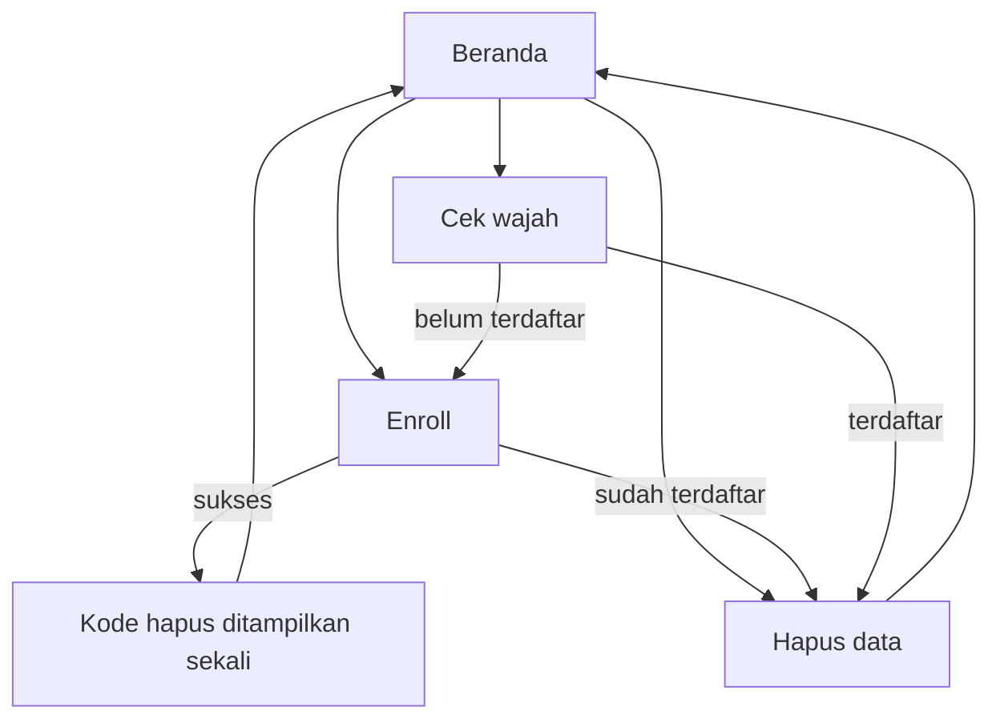

# DESIGN

Desain sengaja polos. Tujuannya satu: pengguna paham apa yang harus dilakukan di setiap langkah. Semua teks UI berbahasa Indonesia dan disimpan di `lang/id/face.php`. Fitur terkait: F-02, F-04, F-06, F-07, F-08, F-09, F-12.

## 1. Prinsip desain
1. **Satu layar, satu tugas, satu tombol utama.** Tidak ada pilihan yang tidak perlu.
2. **Bahasa sehari-hari.** Kata "embedding", "liveness", dan "template" tidak muncul di UI. Gunakan "pindai wajah", "pemeriksaan gerakan", "kode hapus".
3. **Instruksi selalu berupa teks.** Warna dan animasi hanya pendukung, tidak pernah satu-satunya petunjuk.
4. **Jujur soal data.** Layar pendaftaran menyatakan bahwa yang disimpan adalah pola wajah dalam bentuk angka, bukan foto, dan bisa dihapus kapan saja.
5. **Tanpa dekorasi.** Tidak ada gradien, kaca buram (glassmorphism), ilustrasi stok, emoji, atau animasi yang tidak membantu pengguna. Ikon hanya bila perlu (panah arah, salin).
6. **Kesalahan menjelaskan langkah berikutnya**, bukan hanya mengatakan "gagal".

## 2. Daftar layar
### 2.1 Beranda `/` (F-12)
- **Tujuan:** menjelaskan fungsi aplikasi dan mengarahkan ke tiga tugas.
- **Komponen:** judul, dua kalimat penjelasan, tiga tombol/tautan (Daftarkan wajah, Cek wajah, Hapus data wajah), catatan privasi satu kalimat.
- **State:** hanya sukses (halaman statis).

### 2.2 Pendaftaran `/enroll` (F-02, F-03, F-04, F-07, F-09)
- **Tujuan:** mendaftarkan wajah dari persetujuan sampai kode hapus.
- **Komponen:** `ConsentBox`, `CameraCircle`, `InstructionText`, `ProgressSteps`, `AlertBox`, `CodeDisplay`, `PrimaryButton`.

| State | Tampilan | Teks utama (contoh) |
|---|---|---|
| Persetujuan | Penjelasan data + kotak centang. Tombol "Mulai" nonaktif sampai dicentang | "Kami menyimpan pola wajah Anda dalam bentuk angka, bukan foto. Anda bisa menghapusnya kapan saja." |
| Memuat | Teks dan indikator progres sederhana | "Menyiapkan pemindai wajah. Pertama kali bisa memakan waktu beberapa detik." |
| Minta izin kamera | Penjelasan sebelum dialog browser muncul | "Kami butuh akses kamera depan untuk memindai wajah." |
| Izin ditolak / tidak ada kamera | `AlertBox` error + langkah | "Kamera tidak bisa diakses. Izinkan kamera di pengaturan browser, lalu muat ulang halaman." |
| Posisi wajah | Kamera dalam lingkaran. Garis lingkaran abu-abu, berubah hijau saat posisi benar | "Posisikan wajah di dalam lingkaran." Variasi: "Wajah terlalu jauh, dekatkan.", "Wajah terlalu dekat, jauhkan.", "Hanya satu wajah yang boleh terlihat.", "Wajah tidak terlihat." |
| Efek cahaya (F-04) | Area di luar lingkaran berganti merah, biru, hijau berurutan | "Tahan posisi sebentar." |
| Tantangan | Instruksi besar + panah arah + `ProgressSteps` (1 dari 3) | "Kedipkan mata.", "Toleh perlahan ke kanan.", "Toleh perlahan ke kiri." (urutan sesuai server) |
| Memproses | Lingkaran tetap tampil, tombol dinonaktifkan | "Memeriksa…" |
| Sukses | Kode hapus di `CodeDisplay`, tombol Salin, kotak centang "Saya sudah menyimpan kode ini", tombol Selesai aktif setelah dicentang | "Pendaftaran berhasil. Simpan kode hapus ini. Kode hanya ditampilkan sekali dan tidak bisa dilihat lagi." |
| Gagal: gerakan | `AlertBox` + tombol "Coba lagi" (membuat sesi baru) | "Pemeriksaan gerakan belum berhasil. Coba lagi dan ikuti instruksi dengan perlahan." |
| Gagal: sudah terdaftar | `AlertBox` + tautan ke Beranda dan Hapus | "Wajah ini sudah terdaftar." |
| Gagal: kuota penuh | `AlertBox` | "Pendaftaran sedang ditutup karena kuota demo penuh." |
| Gagal: terlalu banyak percobaan | `AlertBox` + hitung mundur dari `retry_after` | "Terlalu banyak percobaan. Coba lagi dalam {n} detik." |

### 2.3 Cek wajah `/check` (F-06)
- **Tujuan:** mengetahui apakah wajah sudah terdaftar.
- **Komponen:** `CameraCircle`, `InstructionText`, `ProgressSteps`, `AlertBox`, `PrimaryButton`.
- **State:** sama dengan enroll sampai tahap memproses (tanpa persetujuan dan tanpa kode hapus), lalu:
  - Sukses, terdaftar: "Wajah ini sudah terdaftar." + tautan "Hapus data wajah".
  - Sukses, belum: "Wajah ini belum terdaftar." + tombol "Daftarkan wajah".
  - Gagal: pesan error seperti di 2.2.

### 2.4 Hapus data `/delete` (F-07, F-08)
- **Tujuan:** menghapus data wajah lewat kode atau pindai wajah.
- **Komponen:** pilihan dua tab ("Pakai kode hapus" / "Pindai wajah"), `CodeInput`, `CameraCircle`, `AlertBox`, `PrimaryButton`.

| State | Tampilan | Teks utama (contoh) |
|---|---|---|
| Pilih cara | Dua tab, default "Pakai kode hapus" | "Pilih cara menghapus data wajah Anda." |
| Input kode | Kolom kode (huruf kapital otomatis, spasi diabaikan, bisa ditempel) | "Masukkan kode hapus yang Anda simpan saat mendaftar." |
| Konfirmasi | Ringkasan + tombol bahaya | "Data wajah akan dihapus permanen dan tidak bisa dikembalikan." Tombol: "Hapus data wajah saya" |
| Pindai wajah (F-08) | Alur kamera seperti 2.3, lalu layar konfirmasi yang sama | "Pindai wajah Anda untuk menghapus data." |
| Memproses | Tombol dinonaktifkan | "Menghapus…" |
| Sukses | Pesan + tautan ke Beranda | "Data wajah Anda sudah dihapus." |
| Gagal: kode salah | `AlertBox`, isi kolom tetap | "Kode tidak ditemukan. Periksa lagi, atau hapus lewat pindai wajah." |
| Gagal: wajah tidak ditemukan | `AlertBox` | "Wajah ini tidak ditemukan di data kami." |
| Gagal: terlalu banyak percobaan | Sama seperti 2.2 | |

Layar "kosong" tidak ada karena aplikasi tidak menampilkan daftar data.

## 3. Pemetaan kode error ke pesan
Frontend menampilkan pesan dari `lang/id/face.php` berdasarkan `error.code` (lihat `docs/API.md`), bukan teks dari server.

| Kode | Pesan untuk pengguna |
|---|---|
| `validation_failed` | "Ada data yang tidak valid. Muat ulang halaman dan coba lagi." |
| `consent_required` | "Anda perlu menyetujui penyimpanan pola wajah untuk melanjutkan." |
| `session_invalid` | "Sesi pemindaian berakhir. Mulai lagi." (tombol "Mulai lagi") |
| `liveness_failed` | "Pemeriksaan gerakan belum berhasil. Coba lagi dan ikuti instruksi dengan perlahan." |
| `face_already_registered` | "Wajah ini sudah terdaftar." |
| `delete_code_invalid` | "Kode tidak ditemukan. Periksa lagi, atau hapus lewat pindai wajah." |
| `face_not_found` | "Wajah ini tidak ditemukan di data kami." |
| `capacity_reached` | "Pendaftaran sedang ditutup karena kuota demo penuh." |
| `rate_limited` | "Terlalu banyak percobaan. Coba lagi dalam {n} detik." |
| `server_error` / jaringan putus | "Terjadi masalah di server. Coba lagi beberapa saat lagi." |

## 4. Navigasi dan alur antar layar

- Header: nama aplikasi (tautan ke Beranda) dan tiga tautan: Daftar, Cek, Hapus.
- Footer: kalimat privasi singkat dan tautan kebijakan privasi (`TODO:` isi setelah review hukum).
- Setelah tantangan gagal, pengguna kembali ke tahap "Posisi wajah" dengan sesi baru. Tidak ada kembali ke persetujuan.

## 5. Design tokens `[REKOMENDASI]`
Tidak ada ketentuan dari pemilik, jadi ini nilai awal yang netral dan mudah diubah.

| Token | Nilai | Keterangan |
|---|---|---|
| `--color-text` | `#1c1917` | Teks utama |
| `--color-bg` | `#ffffff` | Latar |
| `--color-surface` | `#f5f5f4` | Kotak, kolom input |
| `--color-border` | `#d6d3d1` | Garis |
| `--color-accent` | `#1d4ed8` | Tombol utama dan tautan |
| `--color-success` | `#15803d` | Lingkaran saat posisi benar, pesan sukses |
| `--color-danger` | `#b91c1c` | Error, tombol hapus |
| `--color-light-red/blue/green` | `#dc2626` / `#2563eb` / `#16a34a` | Hanya untuk efek cahaya (F-04) |
| Font | `system-ui, sans-serif` | Tanpa font eksternal |
| Ukuran teks | 16px dasar, instruksi tantangan 24px tebal, `line-height` 1,5 | |
| Spasi | skala 4, 8, 16, 24, 32 px | |
| Radius | 8 px | |
| Tinggi tombol | minimal 48 px | Target sentuh |
| Diameter lingkaran | `min(80vw, 320px)`, mode landscape `min(60vh, 320px)` | |

Kontras teks dan tombol minimal WCAG AA (4,5:1).

## 6. Komponen reusable
| Komponen | Fungsi | Dipakai di |
|---|---|---|
| `CameraCircle` | Video terpotong lingkaran (pratinjau dicerminkan), garis warna status | Enroll, Cek, Hapus |
| `InstructionText` | Instruksi besar, `aria-live="polite"` | Enroll, Cek, Hapus |
| `ProgressSteps` | "Langkah 1 dari 3" dengan teks, bukan hanya titik | Enroll, Cek, Hapus |
| `LightEffect` | Latar luar lingkaran berganti merah, biru, hijau (F-04) | Enroll, Cek, Hapus |
| `AlertBox` | Pesan error/info dengan satu tombol aksi | Semua |
| `ConsentBox` | Teks persetujuan + kotak centang | Enroll |
| `CodeDisplay` | Kode hapus huruf monospace, tombol Salin | Enroll |
| `CodeInput` | Kolom kode hapus | Hapus |
| `PrimaryButton` | Tombol utama, status nonaktif dan memuat | Semua |

## 7. Efek cahaya (F-04)
- Berurutan merah, biru, hijau, masing-masing ±0,5 detik dengan transisi halus (±200 ms), sekali saja per sesi. Total ±1,5 detik.
- Tidak ada kedip cepat. Perubahan warna tidak lebih dari tiga kali per detik.
- Dimatikan jika `prefers-reduced-motion: reduce`. Alur lanjut ke tantangan tanpa efek.
- Efek hanya tampilan. Tidak ada analisis pantulan dan tidak mempengaruhi hasil.

## 8. Responsif dan aksesibilitas
- **Mobile-first.** Satu kolom, lebar konten maksimal 480 px dan di tengah pada layar lebar. Tidak ada layout dua kolom.
- Layar kecil (≤ 360 px) dan orientasi landscape tetap menampilkan lingkaran dan instruksi tanpa scroll.
- **Instruksi teks** selalu tampil untuk setiap tantangan, tidak hanya panah atau warna.
- `aria-live="polite"` untuk `InstructionText` dan `AlertBox`. Fokus pindah ke `AlertBox` saat muncul error.
- Semua tombol dan kolom bisa dipakai dengan keyboard. Indikator fokus selalu terlihat.
- Kotak centang dan kolom punya `label` yang terhubung.
- Efek cahaya dan animasi menghormati `prefers-reduced-motion`.
- Kode hapus tidak disimpan di `localStorage` atau URL. Hanya tampil di layar sukses.
- Catatan implementasi: pratinjau kamera dicerminkan seperti cermin, jadi panah "kanan" di layar searah dengan arah toleh pengguna. Perhitungan yaw tetap memakai konvensi di `docs/API.md` (positif = kanan pengguna).
- `TODO:` uji dengan pembaca layar (VoiceOver/TalkBack) pada T-036.
