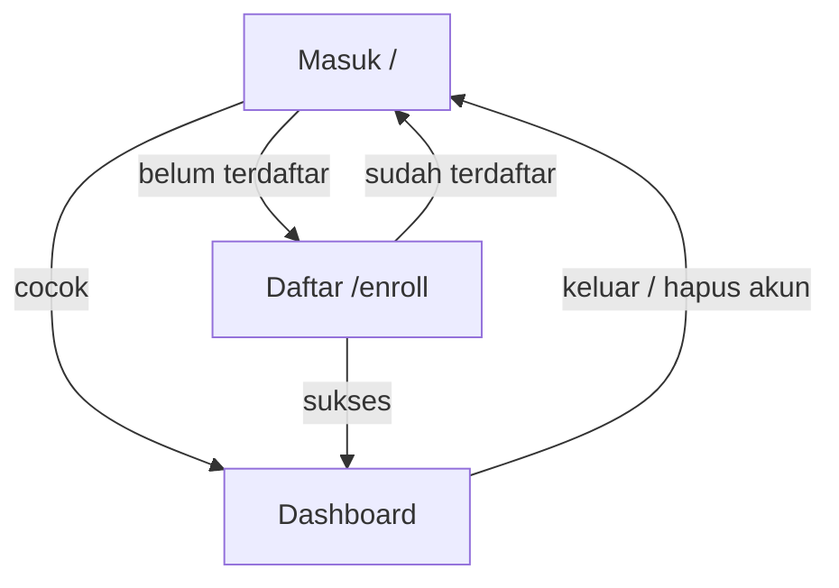

# DESIGN

Desain sengaja polos. Tujuannya satu: pengguna paham apa yang harus dilakukan di setiap langkah. Semua teks UI berbahasa Indonesia dan disimpan di `lang/id/face.php`. Fitur terkait: F-02, F-04, F-09, F-12, F-18–F-21.

## 1. Prinsip desain
1. **Satu layar, satu tugas, satu tombol utama.** Tidak ada pilihan yang tidak perlu.
2. **Bahasa sehari-hari.** Kata "embedding", "liveness", dan "template" tidak muncul di UI. Gunakan "pindai wajah", "pemeriksaan gerakan", "akun", "absen".
3. **Instruksi selalu berupa teks.** Warna dan animasi hanya pendukung, tidak pernah satu-satunya petunjuk.
4. **Jujur soal data.** Layar pendaftaran menyatakan bahwa yang disimpan adalah pola wajah dalam bentuk angka, bukan foto, dan bisa dihapus kapan saja.
5. **Tanpa dekorasi.** Tidak ada gradien, kaca buram (glassmorphism), ilustrasi stok, emoji, atau animasi yang tidak membantu pengguna. Ikon hanya bila perlu (panah arah, salin).
6. **Kesalahan menjelaskan langkah berikutnya**, bukan hanya mengatakan "gagal".

## 2. Daftar layar
### 2.1 Masuk `/` (F-18)
- **Tujuan:** masuk ke akun dengan pindai wajah.
- **Komponen:** `CameraCircle`, `InstructionText`, `ProgressSteps`, `AlertBox`, `PrimaryButton`, tautan "Daftar dengan wajah".
- **State:** memuat, izin kamera, posisi, tantangan, memproses (sama seperti 2.2 tanpa persetujuan), lalu:
  - Sukses: pindah ke `/dashboard`.
  - Gagal, wajah tidak cocok: `AlertBox` "Wajah belum terdaftar…" + "Coba lagi" + tautan "Daftar".
  - Gagal lain: pesan error seperti di 2.2.
  - Setelah hapus akun: `Notice` "Akun dan semua data sudah dihapus."

### 2.2 Pendaftaran `/enroll` (F-02, F-03, F-04, F-09, F-18)
- **Tujuan:** mendaftarkan wajah sebagai akun, lalu langsung masuk.
- **Komponen:** `ConsentBox`, `CameraCircle`, `InstructionText`, `ProgressSteps`, `AlertBox`, `PrimaryButton`.

| State | Tampilan | Teks utama (contoh) |
|---|---|---|
| Persetujuan | Penjelasan data + kotak centang. Tombol "Mulai" nonaktif sampai dicentang | "Kami menyimpan pola wajah Anda dalam bentuk angka, bukan foto. Anda bisa menghapusnya kapan saja." |
| Memuat | Teks dan indikator progres sederhana | "Menyiapkan pemindai wajah. Pertama kali bisa memakan waktu beberapa detik." |
| Minta izin kamera | Penjelasan sebelum dialog browser muncul | "Kami butuh akses kamera depan untuk memindai wajah." |
| Izin ditolak / tidak ada kamera | `AlertBox` error + langkah | "Kamera tidak bisa diakses. Izinkan kamera di pengaturan browser, lalu muat ulang halaman." |
| Posisi wajah | Kamera dalam lingkaran. Garis lingkaran abu-abu, berubah hijau saat posisi benar | "Posisikan wajah di dalam lingkaran." Variasi: "Wajah terlalu jauh, dekatkan.", "Wajah terlalu dekat, jauhkan.", "Hanya satu wajah yang boleh terlihat.", "Wajah tidak terlihat.", "Lepas kacamata." (F-17) |
| Efek cahaya (F-04) | Area di luar lingkaran berganti merah, biru, hijau berurutan | "Tahan posisi sebentar." |
| Tantangan | Instruksi besar + panah arah + `ProgressSteps` (1 dari 3) | "Kedipkan mata.", "Toleh perlahan ke kanan.", "Toleh perlahan ke kiri." (urutan sesuai server) |
| Memproses | Lingkaran tetap tampil, tombol dinonaktifkan | "Memeriksa…" |
| Sukses | Pindah ke `/dashboard` (sudah masuk) | — |
| Gagal: gerakan | `AlertBox` + tombol "Coba lagi" (membuat sesi baru) | "Pemeriksaan gerakan belum berhasil. Coba lagi dan ikuti instruksi dengan perlahan." |
| Gagal: sudah terdaftar | `AlertBox` + tautan "Masuk" | "Wajah ini sudah terdaftar. Silakan masuk." |
| Gagal: kuota penuh | `AlertBox` | "Pendaftaran sedang ditutup karena kuota demo penuh." |
| Gagal: terlalu banyak percobaan | `AlertBox` + hitung mundur dari `retry_after` | "Terlalu banyak percobaan. Coba lagi dalam {n} detik." |

### 2.3 Dashboard `/dashboard` (F-19, F-20, F-21)
- **Tujuan:** isi nama, absen, lihat riwayat, hapus data.
- **Komponen:** `Notice`, form nama, `PrimaryButton`, daftar riwayat, `ConfirmDetails`.

| State | Tampilan | Teks utama |
|---|---|---|
| Nama kosong | Judul "Isi nama Anda", form nama dengan tombol utama, bagian hapus data. Absen dan riwayat tidak tampil | "Isi nama dulu sebelum absen." |
| Belum absen hari ini | "Halo, {nama}", tombol utama "Absen sekarang" | "Absen sekali sehari, jam bebas." |
| Sudah absen hari ini | Teks status menggantikan tombol | "Sudah absen pukul 08.12" |
| Riwayat | Daftar 30 absen terakhir: hari, tanggal, jam | Kosong: "Belum ada absen." |
| Ubah nama | Form nama terisi, tombol outline | "Nama tersimpan." |
| Nama tidak valid | Pesan di bawah kolom, `aria-invalid` | "Isi nama Anda." / "Nama maksimal 100 karakter." |
| Hapus riwayat | `ConfirmDetails` → penjelasan + tombol bahaya | "Semua riwayat absen dihapus permanen. Akun tetap ada." |
| Hapus akun | `ConfirmDetails` → penjelasan + tombol bahaya → kembali ke `/` | "Pola wajah, nama, dan semua riwayat absen dihapus permanen." |

## 3. Pemetaan kode error ke pesan
Frontend menampilkan pesan dari `lang/id/face.php` berdasarkan `error.code` (lihat `docs/API.md`), bukan teks dari server.

| Kode | Pesan untuk pengguna |
|---|---|
| `validation_failed` | "Ada data yang tidak valid. Muat ulang halaman dan coba lagi." |
| `consent_required` | "Anda perlu menyetujui penyimpanan pola wajah untuk melanjutkan." |
| `session_invalid` | "Sesi pemindaian berakhir. Mulai lagi." (tombol "Mulai lagi") |
| `liveness_failed` | "Pemeriksaan gerakan belum berhasil. Coba lagi dan ikuti instruksi dengan perlahan." |
| `face_already_registered` | "Wajah ini sudah terdaftar. Silakan masuk." |
| `face_not_found` | "Wajah belum terdaftar. Daftar dulu, atau coba lagi dengan cahaya lebih terang." |
| `capacity_reached` | "Pendaftaran sedang ditutup karena kuota demo penuh." |
| `rate_limited` | "Terlalu banyak percobaan. Coba lagi dalam {n} detik." |
| `server_error` / jaringan putus | "Terjadi masalah di server. Coba lagi beberapa saat lagi." |

## 4. Navigasi dan alur antar layar

- Header tamu: nama aplikasi, tautan Masuk dan Daftar. Header akun: tautan Absen (dashboard) dan tombol Keluar.
- Footer: kalimat privasi singkat dan tautan kebijakan privasi (`TODO:` isi setelah review hukum).
- Setelah tantangan gagal, pengguna kembali ke tahap "Posisi wajah" dengan sesi baru. Tidak ada kembali ke persetujuan.

## 5. Design tokens
Arahan pemilik (2026-11-20): gaya netral seperti shadcn/ui, ditulis sendiri tanpa mengambil komponen shadcn. Palet zinc, primer hampir hitam. Satu-satunya aksen warna adalah cincin hijau saat posisi wajah benar. Dial: ENERGY 1 / RHYTHM 1 / MOTION 1. Nilai ada di `resources/css/app.css`.

| Token | Terang | Gelap | Keterangan |
|---|---|---|---|
| `--background` / `--foreground` | `#ffffff` / `#09090b` | `#09090b` / `#fafafa` | Latar dan teks utama |
| `--card` | `#ffffff` | `#0c0c0f` | Kartu halaman tugas (≥ 640 px) dan kartu beranda |
| `--muted` / `--muted-foreground` | `#f4f4f5` / `#71717a` | `#27272a` / `#a1a1aa` | Permukaan sekunder, teks pendukung. Teks muted tidak dipakai di atas `--muted` (4,4:1 di mode terang) |
| `--border` | `#e4e4e7` | `#27272a` | Garis kartu dan pemisah |
| `--control` | `#8a8a94` | `#6b6b76` | Tepi input, tombol outline, lingkaran kamera (≥ 3:1, WCAG 1.4.11) |
| `--primary` / `--primary-foreground` | `#18181b` / `#fafafa` | `#fafafa` / `#18181b` | Tombol utama |
| `--destructive` / `--destructive-text` | `#dc2626` / `#b91c1c` | `#dc2626` / `#f87171` | Tombol hapus, kotak error |
| `--success` | `#15803d` | `#4ade80` | Cincin kamera saat posisi benar |
| `--light-red/blue/green` | `#dc2626` / `#2563eb` / `#16a34a` | sama | Hanya untuk efek cahaya (F-04) |
| Font | `system-ui` | | Tanpa font eksternal |
| Ukuran teks | 16 px dasar, label/tombol 14 px, judul `clamp(24px, 4vw, 30px)`, instruksi `clamp(20px, 5vw, 24px)` | | |
| Radius | 6 px (tombol, input), 8 px (kartu kecil, alert), 12 px (kartu halaman) | | |
| Tinggi tombol dan input | minimal 44 px | | Target sentuh |
| Diameter lingkaran | `min(80vw, 320px)`, landscape pendek `min(55vh, 320px)` | | |

Tema: mengikuti sistem sampai pengguna menekan tombol tema di header, lalu pilihan disimpan di `localStorage` (hanya tema, tidak ada data lain).

Kontras teks dan tombol minimal WCAG AA (4,5:1), dicek untuk kedua tema.

## 6. Komponen reusable
| Komponen | Fungsi | Dipakai di |
|---|---|---|
| `CameraCircle` | Video terpotong lingkaran (pratinjau dicerminkan), garis warna status | Masuk, Daftar |
| `InstructionText` | Instruksi besar, `aria-live="polite"` | Masuk, Daftar |
| `ProgressSteps` | "Langkah 1 dari 3" dengan teks, bukan hanya titik | Masuk, Daftar |
| `LightEffect` | Latar luar lingkaran berganti merah, biru, hijau (F-04) | Masuk, Daftar |
| `AlertBox` | Pesan error/info dengan satu tombol aksi | Semua |
| `ConsentBox` | Teks persetujuan + kotak centang | Enroll |
| `Notice` | Hasil aksi form terakhir (`role="status"`) | Masuk, Dashboard |
| `ConfirmDetails` | `
` merah sebagai langkah konfirmasi hapus, tanpa JavaScript | Dashboard |
| `PrimaryButton` | Tombol utama, status nonaktif dan memuat | Semua |

## 7. Efek cahaya (F-04)
- Berurutan merah, biru, hijau, masing-masing ±0,5 detik dengan transisi halus (±200 ms), sekali saja per sesi. Total ±1,5 detik.
- Tidak ada kedip cepat. Perubahan warna tidak lebih dari tiga kali per detik.
- Dimatikan jika `prefers-reduced-motion: reduce`. Alur lanjut ke tantangan tanpa efek.
- Efek hanya tampilan. Tidak ada analisis pantulan dan tidak mempengaruhi hasil.

## 8. Responsif dan aksesibilitas
- **Mobile-first, tiga rentang lebar.**
  - HP (< 640 px): satu kolom tanpa bingkai kartu, margin 16 px. Header dua baris: nama dan tombol tema di atas, tautan sama lebar di bawah.
  - Mulai 640 px: setiap halaman (masuk, daftar, dashboard) menjadi kartu di tengah (maks. 520 px), satu kolom.
  - Header satu baris mulai 520 px.
- Layar kecil (≤ 360 px) dan orientasi landscape tetap menampilkan lingkaran dan instruksi tanpa scroll.
- **Instruksi teks** selalu tampil untuk setiap tantangan, tidak hanya panah atau warna.
- `aria-live="polite"` untuk `InstructionText` dan `AlertBox`. Fokus pindah ke `AlertBox` saat muncul error.
- Semua tombol dan kolom bisa dipakai dengan keyboard. Indikator fokus selalu terlihat.
- Kotak centang dan kolom punya `label` yang terhubung.
- Efek cahaya dan animasi menghormati `prefers-reduced-motion`.
- Catatan implementasi: pratinjau kamera dicerminkan seperti cermin, jadi panah "kanan" di layar searah dengan arah toleh pengguna. Perhitungan yaw tetap memakai konvensi di `docs/API.md` (positif = kanan pengguna).
- `TODO:` uji dengan pembaca layar (VoiceOver/TalkBack) pada T-036.
